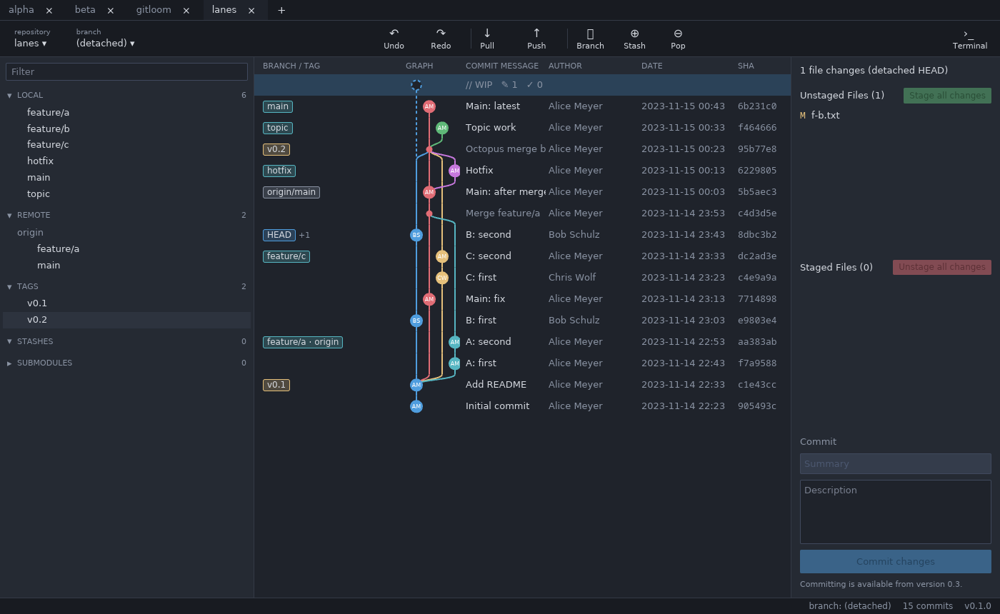

# Gitloom

A fast, open-source Git client with the workflow GitKraken users already know. Native Rust, no webview, no subscription.

> Working title. Not affiliated with GitKraken or Axosoft.



## Status

Early development. Version 0.3.0 (M2) covers the daily loop without a terminal: changes appear automatically, stage and discard by file, hunk or line, commit and amend, stash and pop, undo and redo. Writes go through the `git` executable, so hooks and signing work as usual. Branches, checkout and remotes follow in M3. See [docs/ROADMAP.md](docs/ROADMAP.md).

| Milestone | Version | State |
|---|---|---|
| M0 Layout shell | 0.1.0 | Done |
| M1 Real repository (read-only) + lane graph | 0.2.0 | Done |
| M2 Working copy | 0.3.0 | Done |
| M3 Branches and remotes | 0.4.0 | Next |
| M4 Merge, rebase, conflicts | 0.5.0 | Planned |
| M5 Productivity parity | 0.6.0 | Planned |
| M6 Release readiness | 1.0.0 | Planned |

## Build

Requires Rust 1.88+ (rustup picks the toolchain from `rust-toolchain.toml`).

```sh
cargo run -p gitloom
cargo run -p gitloom -- <path-to-repository>
```

Linux needs X11/Wayland libraries and `libxkbcommon`. Without a GPU, use the software renderer:

```sh
ICED_BACKEND=tiny-skia cargo run -p gitloom
```

## Documentation

| Document | Content |
|---|---|
| [ROADMAP](docs/ROADMAP.md) | Milestones, non-goals, ideas |
| [M1 plan](docs/milestones/M1-real-repository.md) | M1 tasks and notes (done) |
| [M2 plan](docs/milestones/M2-working-copy.md) | M2 tasks and notes (done) |
| [PERFORMANCE](docs/PERFORMANCE.md) | Measurements |
| [ARCHITECTURE](docs/ARCHITECTURE.md) | Crates, threading, graph layout |
| [DECISIONS](docs/DECISIONS.md) | Architecture decision records |
| [UX-PARITY](docs/UX-PARITY.md) | GitKraken layout, interactions, shortcuts |
| [HANDOVER](docs/HANDOVER.md) | Current state, open questions |
| [CONTRIBUTING](CONTRIBUTING.md) | Setup, git flow, commit style |
| [CLAUDE.md](CLAUDE.md) | Instructions for Claude Code |

## License

Licensed under either of [Apache License 2.0](LICENSE-APACHE) or [MIT license](LICENSE-MIT) at your option.
