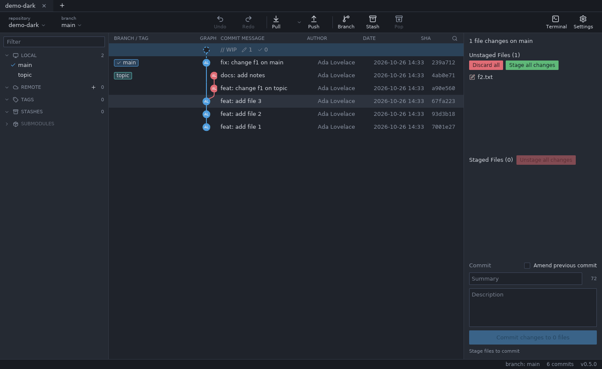
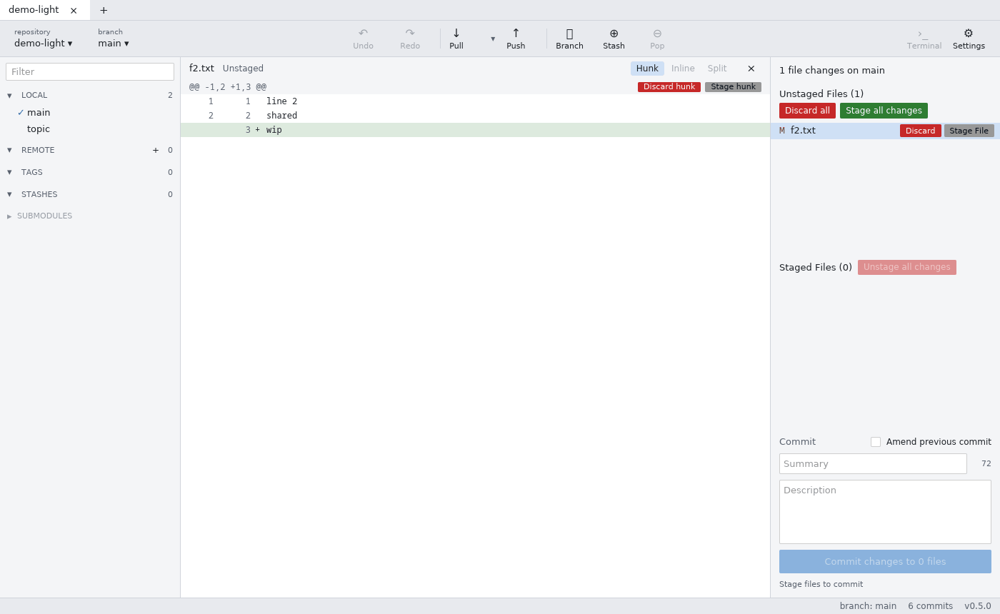
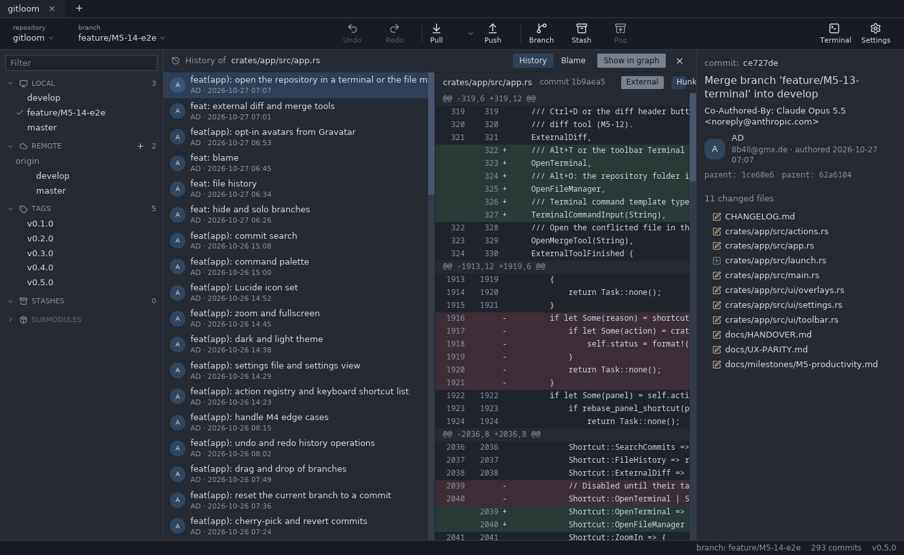

# Daily workflow

## The graph

Every commit is a row: branch and tag pills, the lane graph, the message, author, date and SHA. Each branch keeps its lane and color; merges and forks are curved lines. Local and remote branches on the same commit share one pill (a cloud icon names the remotes in its tooltip); more references collapse into "+N". Local branches show how many commits they are ahead (↑) or behind (↓) their upstream. Stashes are square nodes attached to their base commit. Large histories are cut off at 100 000 commits ("History truncated").

- Click a commit for its details on the right; click a file there to see its diff.
- Ctrl+click and Shift+click (or Shift+↑/↓) select several commits; the right panel lists them.
- ↓/J and ↑/K move the selection, Shift+J/K follow the branch, Ctrl+Home/Ctrl+End jump to the first/last commit.
- Clicking a branch in the left panel jumps to its commit. Branch names with `/` are grouped into folders (click a folder or remote to collapse it; remembered per repository); the checked-out branch is highlighted.

**Search** (Ctrl+F or the magnifier above the graph): type part of a message, author, email or SHA. Other commits are dimmed, "n of m" counts the matches, Enter / Shift+Enter jump to the next / previous one, Esc closes the search.

**Hide and solo branches:** the eye that appears when you hover a branch in the left panel hides it from the graph; the branch menu also has **Solo**, which shows only soloed branches (and HEAD). A remote's menu hides or shows all its branches. This is remembered per repository. While anything is hidden or soloed, "Viewing x/y · Show All" above the filter says how many branches are shown, and **Show All** shows them all again.

## Diffs

Clicking a file shows its diff in the center. Three views, switched in the diff header (or the palette, "Diff: … view"); the choice is remembered:

- **Hunk**: only the changed parts with 3 lines around them, each hunk with a header.
- **Inline**: the whole file; a bar above every change block offers **Stage block** / **Unstage block** / **Discard block**.
- **Split**: old (left) and new (right) side by side with the same bars; changed lines are paired, added or deleted files show "File added" / "File deleted" on the empty side.

In Inline and Split the arrows in the header jump to the previous / next change, and opening a file shows its first change. Old and new line numbers, + and − markers and colors are the same in all views. Binary and very large files get a short explanation instead. In partial (blobless) clones, missing file contents are fetched through Git when a diff needs them.

**External** (or Ctrl+D) opens the diff in your diff tool, **History** opens the file history.

## Staging

Select the **WIP** row at the top of the graph. The right panel lists unstaged, staged and conflicted files; changes made outside Gitloom (editor, build, a terminal) appear within a second.

- Hover a file for **Stage** / **Unstage** and **Discard**; or right click it.
- **Stage all changes** / **Unstage all changes**, Ctrl+Shift+S / Ctrl+Shift+U.
- With a file's diff open: **S** stages it, **U** unstages it; the next file's diff opens.
- In the diff: **Stage hunk** in a hunk header (Hunk view) or **Stage block** above a change (Inline, Split), or select lines (click, Shift+click, Ctrl+click; in Split removed lines on the left, added lines on the right) and **Stage selected lines**.
- **Discard** works per file, hunk, selected lines or for all changes. It always asks first and can be undone (Ctrl+Z). "Discard all" with staged changes asks whether to discard those too.
- File menu: **Ignore** (adds the file to `.gitignore`), **Open file location**, **Copy file path**, **File history**.

## Committing

Write a summary (the counter shows the remaining characters of 72) and an optional description, then **Commit** or Ctrl+Enter; Ctrl+Shift+Enter stages everything first. Ctrl+Shift+M jumps to the summary. Hooks run as usual; if one fails, its output is shown and your message is kept. `commit.template` prefills the description.

**Amend previous commit** fills the message from the last commit; you can amend only the message. Gitloom warns when that commit is already pushed.

With a detached HEAD, the commit panel reminds you to create a branch.

## Stashing

**Stash** in the toolbar stashes all changes including untracked files; **Pop** applies and removes the newest stash. Right click a stash (left panel or graph) for **Apply**, **Pop** and **Delete**. Selecting a stash shows its staged, unstaged and untracked files.

## File history and blame

Right click a file → **File history**, the **History** button of a diff, or Ctrl+Shift+H to pick any tracked file. The list shows every commit that changed the file, following renames, with its diff; **Show in graph** jumps to the commit.

Switch to **Blame** to see author, commit and age for each block of lines, for the working copy or any commit of the history; clicking a block shows that commit.

## Terminal and file manager

**Terminal** in the toolbar or Alt+T opens your terminal in the repository; Alt+O (or "Open file location") opens the file manager. The terminal command can be set in Preferences → External tools.
