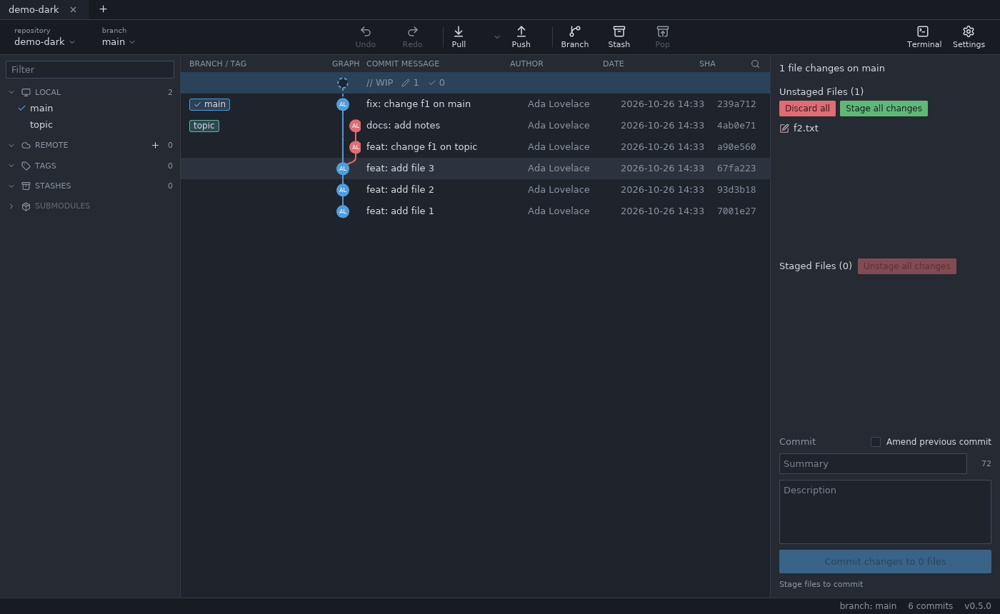
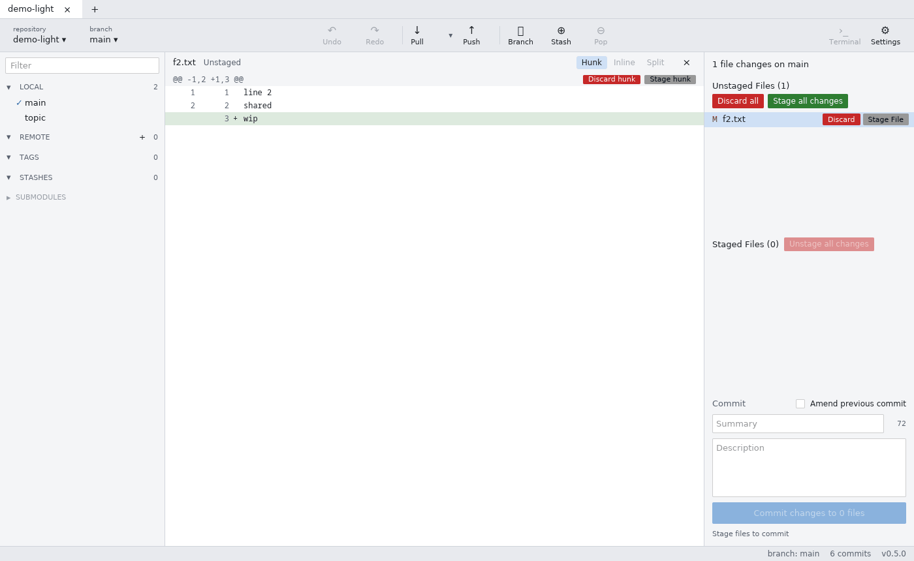
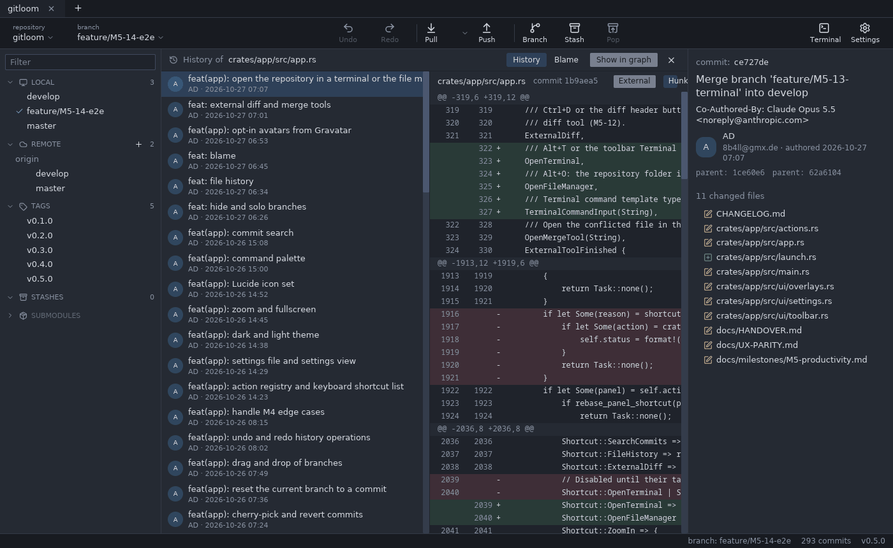

# Daily workflow

## The graph

Every commit is a row: branch and tag pills, the lane graph, the message, author, date and SHA. Each branch keeps its lane and color; merges and forks are curved lines. Local and remote branches on the same commit share one pill (a cloud icon names the remotes in its tooltip); more references collapse into "+N". Local branches show how many commits they are ahead (↑) or behind (↓) their upstream. Stashes are dashed squares with a stash icon attached to their base commit, labelled "WIP on <branch>" (or the message you gave). Large histories are cut off at 100 000 commits ("History truncated").

- Click a commit for its details in the details panel (right of the graph, or below it when pinned to the bottom); click a file there to see its diff.
- Small pills at the right of the commit message mark where the age changes ("just now", "25 minutes ago", "yesterday", "3 days ago", "2 months ago"); they update every minute.
- Ctrl+click and Shift+click (or Shift+↑/↓) select several commits; the details panel lists them.
- ↓/J and ↑/K move the selection, Shift+J/K follow the branch, Ctrl+Home/Ctrl+End jump to the first/last commit.
- Clicking a branch in the left panel jumps to its commit. Branch and tag names with `/` are grouped into folders (click a folder or remote to collapse it; remembered per repository); every level lists branches (or tags) first, then folders. The checked-out branch is highlighted and has a check next to its branch icon.
- The small panel icons at the left and right end of the status bar hide and show the left panel and the details panel (also Ctrl+J and Ctrl+K); a filled side means the panel is shown.
- The arrow left of the details panel toggle moves the details panel to the bottom (under the graph, right of the left panel) and back; the palette has the same action ("Move details panel to the bottom" / "… to the right"). The panel toggle icon shows where the panel is. The choice is remembered; diffs, the conflict view and the file history still open in the center, above the panel.

**Columns:** drag the border at the right of any column header to change that column's width (only that one changes); a double click sets the width that fits the visible rows, on the Commit message border it goes back to filling the free space. A table wider than the window scrolls sideways: the scrollbar below the rows, Shift+wheel or a horizontal wheel; the header moves along. The gear at the right end of the header shows or hides Author, Date and SHA and has **Reset column widths**. Widths are kept across restarts. A Graph column narrower than its lanes keeps every commit visible: the lanes that do not fit put their nodes into the column's last lane (in their own colors, without lines); at the narrowest width all nodes sit on one line.

**Search** (Ctrl+F or the magnifier above the graph): type part of a message, author, email or SHA. Other commits are dimmed, "n of m" counts the matches, Enter / Shift+Enter jump to the next / previous one, Esc closes the search.

**Hide and solo branches:** the eye that appears when you hover a branch in the left panel hides it from the graph; the branch menu also has **Solo**, which shows only soloed branches (and HEAD). A remote's menu hides or shows all its branches. This is remembered per repository. While anything is hidden or soloed, "Viewing x/y · Show All" above the filter says how many branches are shown, and **Show All** shows them all again.

## Commit details

The commit details never scroll as a whole; only the message box and the file list scroll inside their frames.

- **commit: <sha>** at the top left copies the full SHA with a click. While the pointer is over this row or the message, a button appears at its right end: a pencil for a commit you can edit, otherwise an open icon; both open the message in a window (see below).
- The message sits in a framed box of at most a fifth of the panel (at least three lines); select text in it and copy it with Ctrl+C. Long descriptions scroll inside the box.
- The author block shows the avatar, the author and "authored <date>"; "committed by <name> <date>" when someone else committed (e.g. after a rebase or `git am`). `Co-authored-by:` lines at the end of the message appear as small avatars after "Co-authors:" (name and e-mail in the tooltip). **parent: <sha>** links select the parent and scroll to it.
- A summary line ("2 changed files", "1 added · 1 modified") and a toolbar sit above the file list: it sorts A→Z or Z→A, switches between **Path** (full paths) and **Tree** (folders), and **View all files** lists every file of the commit, the unchanged ones muted; click one to see its content at that commit. These options are remembered.
- The files are listed in their own frame with its own scrollbar. In Tree mode its first row is one button: **Collapse all** while every folder is open, otherwise **Expand all** (collapsing a single folder switches it back to **Expand all**). A stash shows its Staged, Unstaged and Untracked sections in the frame.

### Edit a commit message

Hover the commit details header or the message of a commit that you have not pushed yet and click the pencil at the right of the header (or use **Edit commit message…** in the command palette): the **Commit message** window opens with the parts of the staging area: **Authored by …** with a menu to change the author (**Keep original author**, the repository's identity, saved identities, **Other…**), the sparkle for the commit message prompt, the summary (and its counter) and the description, which grows with the text. **Save** (Ctrl+Enter, or Enter in the summary) or **Cancel** (Esc); one save changes message and author together and selects the rewritten commit. With changes, Esc, Cancel, × or a click beside the window ask **Discard changes?** (**Keep editing** / **Discard**). If saving fails (for example because the branch moved meanwhile), a notification explains it and the window stays open with your text. The sparkle opens **Copy commit message prompt…** for this commit (its diff against the first parent, the commits before it).

**Change author…** in the menu of a commit changes the author of that commit, or of all selected commits when you right click one of several (Ctrl/Shift+click). Choose the repository's identity, a saved one or **Other…** (name and e-mail); the author dates are kept, Ctrl+Z restores all of them in one step. It is disabled with the reason (e.g. "a1b2c3d: Already pushed to origin/main …") when one of them cannot be changed. A click on the text itself only selects it. This works for the newest commit and for older ones on the checked-out branch, also when merges follow: Gitloom rebuilds the commits after it with the same files, authors and dates, and moves the branch. Your working tree and staged changes are not touched. Other branches and tags that contain the commit keep the old one; the editor lists them before you save. With commit signing on, the rebuilt commits are signed again; with it off, the editor says that their signatures are removed.

The message cannot be edited when the commit is already on a remote ("Already pushed to origin/main. Use interactive rebase to change pushed history."), when it is not on the checked-out branch, while a merge, rebase, cherry-pick or revert runs, while Gitloom is busy, or for a stash ("Stashes cannot be edited"). The button then shows the open icon (**Open message**) and the window opens read-only: the reason at the top, the summary and description to select, **Copy message** (summary and description) and **Close**. Ctrl+Z undoes an edit.

## Diffs

Code is syntax highlighted (shown plain for a moment first; long files get their colors from the top down); font, size, tabs, line numbers and word wrap are set in Preferences → Editor. In changed lines the characters that differ from the line they replace have a stronger red or green background (for example only `pub(crate) ` when `fn x` became `pub(crate) fn x`); lines that have little in common are not marked. If a file stays plain or gets the wrong colors (for example `project.godot`, which is INI), click the language at the right of the status bar, type a name such as `ini` and choose it; **Auto Detect** at the top of the list undoes this. The choice applies to that file in this repository and is forgotten when you close its tab.

Clicking a file shows its diff in the center. The header has icons like GitKraken: **Blame**, **History**, the change arrows, the view toggle (**Hunk** / **Inline** / **Split**), **External** and **Close**; their tooltips name them and their shortcuts. Three views, switched in the header (or the palette, "Diff: … view"); the choice is remembered:

- **Hunk**: only the changed parts with 3 lines around them, each hunk with a header.
- **Inline**: the whole file; a bar above every change block offers **Stage block** / **Unstage block** / **Discard block**.
- **Split**: old (left) and new (right) side by side with the same bars; changed lines are paired, added or deleted files show "File added" / "File deleted" on the empty side.

In Inline and Split the arrows in the header jump to the previous / next change, and opening a file shows its first change. A minimap right of the scrollbar marks removed (red) and added (green) lines, in Split on the left and right half, and shows the visible part; click or drag in it to jump there, the mouse wheel scrolls. Old and new line numbers, + and − markers and colors are the same in all views. Binary and very large files get a short explanation instead. In partial (blobless) clones, missing file contents are fetched through Git when a diff needs them.

Switching to another tab (or to a new tab's start screen) closes the diff, the blame and the file history of the tab you leave, like **Close**: coming back shows the graph. Staged lines stay staged. A conflict view with picks or edits that are not saved yet stays open.

**External** (or Ctrl+D) opens the diff in your diff tool (without one: "No diff tool" with **Define tool…**, which opens Preferences → External tools at the command field), **History** opens the file history, **Blame** the file's blame (at the commit of a commit diff, otherwise the working file; not for untracked, added or deleted files and stashes).

## Staging

Select the **WIP** row at the top of the graph. The details panel lists unstaged, staged and conflicted files; changes made outside Gitloom (editor, build, a terminal) appear within a second.

With the details panel at the bottom, **Unstaged Files** and **Staged Files** sit side by side (with the sort and **Path** / **Tree** buttons above them), **Discard all changes** is the trash icon left of the title, and the commit message and the **Commit** button span the full width. Drag the grey bar between the lists and the commit message up or down to share the height; the position is remembered.

- Hover a file for **Stage** / **Unstage** and **Discard**; or right click it.
- **Stage all changes** / **Unstage all changes**, Ctrl+Shift+S / Ctrl+Shift+U.
- With a file's diff open: **S** stages it, **U** unstages it; the next file's diff opens.
- In the diff: **Stage hunk** in a hunk header (Hunk view) or **Stage block** above a change (Inline, Split), or select lines (click, Shift+click, Ctrl+click; in Split removed lines on the left, added lines on the right) and **Stage selected lines**.
- **Discard** works per file, hunk, selected lines or for all changes. It always asks first and can be undone (Ctrl+Z). "Discard all" with staged changes asks whether to discard those too.
- File menus are ordered like GitKraken's. Unstaged: **Stage**, **Discard changes**, **Ignore** (adds the file to `.gitignore`); staged: **Unstage**, **Discard changes** (staged and unstaged changes of the file, back to HEAD; undoable), **Copy commit message prompt…**. All file menus, also in the commit details: **File history**, **File blame**, **Open in external diff tool**, **Open in external editor**, **Open file location**, **Copy file path**.
- **Open in external diff tool** uses the diff tool from Preferences → External tools: unstaged files compare the index with the working tree, staged files HEAD with the index, files of a commit its first parent with the commit (Git writes both versions to temporary files and removes them afterwards).

## Committing

Write a summary (the counter inside the field shows the remaining characters of 72; it turns yellow at 10 and red below 0, committing still works) and an optional description, then **Commit** or Ctrl+Enter; Ctrl+Shift+Enter stages everything first. Ctrl+Shift+M jumps to the summary. Hooks run as usual; if one fails, its output is shown and your message is kept. An empty message is prefilled from the commit template (Preferences → Repository → Commit): its first line becomes the summary, the rest the description; comment lines are removed when that option is on, also from the message you commit. A commit that fails to sign says "Signing failed" and points to Preferences → Signing; signed commits show their status after the author in the commit details.

**Copy commit message prompt…** (the sparkle button right of "Committing as …", right click the Staged Files header or a staged file, or the command palette) builds a prompt for a tool of your choice: the instruction from Preferences → Templates, the commit template, the branch, the last 10 commit summaries, the staged files with their added/removed lines and the staged diff (up to 60,000 characters; binary files and files over 256 KB are listed without their diff). The dialog shows the size and what was left out; **Copy** (or Ctrl+C) puts it on the clipboard. Check the diff for secrets before you share it. Gitloom itself sends nothing anywhere.

**Amend previous commit** fills the message from the last commit; you can amend only the message. Gitloom warns when that commit is already pushed.

With a detached HEAD, the staging area reminds you to create a branch.

**Committing as <name> <email>** above the summary shows the identity the next commit uses; the tooltip says whether it comes from the repository's or the global Git config. Click it to use one of your saved identities in this repository (written to `user.name`/`user.email` of the repository config), **Use global identity** to remove the repository's own values, **Save as identity** to keep the current one, or **Manage identities…**. The same choices are in the command palette ("Choose identity…") and in Preferences → Repository → Identity. Without a name and email, the line reads "No Git identity set" and Commit, Amend and Continue stay disabled until you choose or add one. Saved identities and the default live in Preferences → Identities ([Settings](settings.md)).

## Stashing

**Stash** in the toolbar stashes all changes including untracked files (with the stash message template of Preferences → Templates when it is on, else Git's default message, shown as "WIP on <branch>"); **Pop** applies and removes the newest stash. Right click a stash (left panel or graph) for **Apply**, **Pop**, **Rename stash…** and **Delete**. A `/` in a stash's name puts it into a folder in STASHES (Git's default "WIP on <branch>" names are never split); stashes keep their order, folders follow. Renaming keeps the stash at its place in the list. Stash, Delete and Rename can be undone. Selecting a stash shows its staged, unstaged and untracked files. Pop and Apply can be undone; if they conflict, see [Stash conflicts](merge-rebase-conflicts.md#stash-conflicts).

## File history and blame

Right click a file → **File history** or **File blame** (opens the blame directly: the working copy, or the file at the commit whose details you are viewing; a file deleted there is blamed at the parent), the **History** button of a diff, or Ctrl+Shift+H to pick any tracked file. The list shows every commit that changed the file, following renames, with its diff; **Show in graph** jumps to the commit.

Switch to **Blame** to see author, commit and age for each block of lines, for the working copy or any commit of the history; clicking a block shows that commit.

## Terminal, editor and file manager

**Terminal** in the toolbar or Alt+T opens your terminal in the repository; Alt+O (or "Open file location") opens the file manager. The terminal command can be set in Preferences → External tools.

With an external editor set (Preferences → External tools), **Editor** in the toolbar, Alt+E or "Open repository in editor" in the palette opens the repository in it; **Open in external editor** in the context menu of a file (unstaged, staged, commit files, file history) opens that file. Deleted files cannot be opened.

## Several branches and tags at once

Ctrl+click and Shift+click select several branches and tags in the left panel; right click one of them to delete them all or hide them in the graph. See [Branches and remotes](branches-and-remotes.md#selecting-several-branches-and-tags).
