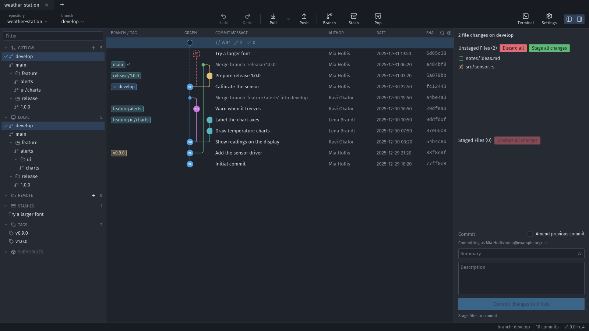

# Getting started

## Install

Gitloom needs **Git 2.34 or newer** on the `PATH` for everything that changes a repository (commit, checkout, fetch, …). Without Git you can still browse history; write actions are disabled and say why.

Download the package for your system from the [releases page](https://github.com/a-denisov-psb/gitloom/releases). `SHA256SUMS` lists the checksum of every file.

- **Windows (x64, x86):** run the `.msi` installer (asks for administrator rights) or unpack the portable `.zip` anywhere and start `gitloom.exe`. Until the binaries are signed, SmartScreen may warn: **More info** → **Run anyway**.
- **macOS 11 or newer (Apple silicon and Intel):** open the `.dmg` and drag Gitloom to Applications. The app is not notarized by Apple, so the first start is blocked: right click the app → **Open** → **Open**, or System Settings → Privacy & Security → **Open Anyway**.
- **Linux x64 (glibc 2.35 or newer):** make the AppImage executable (`chmod +x Gitloom-*.AppImage`) and run it. The `.tar.gz` contains the binary, a desktop entry (`io.github.a_denisov_psb.Gitloom.desktop`), AppStream metadata and an icon; copy the desktop entry to `~/.local/share/applications/` and the icon to `~/.local/share/icons/hicolor/256x256/apps/` to get a menu entry. On Debian and Ubuntu, `sudo apt install ./gitloom_*_amd64.deb` installs it with a menu entry.
- **Windows on ARM64 and Linux ARM64 (best effort, not in every release):** the Windows portable `.zip` and the Linux `.AppImage` / `.tar.gz` work as described above.

## Open a repository

- Start screen (like GitKraken's New Tab): **Open a repo** (native folder dialog), a typed path below it, or a recent repository; Customize opens the Preferences or the identities; Resources open the user guide, the issue tracker and the release notes in the browser.
- **Ctrl+O** opens the folder dialog, **Ctrl+Shift+O** the list of recent repositories.
- From a terminal: `gitloom <path> [<path>...]` opens each path in its own tab. A subfolder opens its repository; an already open repository switches to its tab. On Windows the terminal returns to the prompt right away.

Gitloom remembers the open tabs, the active tab and the pane sizes and restores them on the next start. The start screen lists up to 20 recent repositories; a missing one can be removed from the list.

## Clone a repository

Start screen → **Clone a repo**: paste the URL (HTTPS, SSH or a local path), choose **Where to clone to** (Browse… or type a folder; it starts with the folder of your most recent repository) and check the **Name** (taken from the URL, editable); **Full path** shows the result. **Clone submodules** is on by default. **Clone** shows Git's progress in the dialog; **Cancel** (or Esc) stops it. Credentials are asked like for fetch and never stored. The target must not exist or must be an empty folder; a failed or cancelled clone leaves no new folder behind. The clone opens in the same tab and appears in the recent list.

## Start a local repository

Start screen → **Start a local repo**: **Name**, **Initialize in** (the parent folder), **Default branch** (from `init.defaultBranch`, else `main`), **Create README.md** and a **.gitignore template** (C++, Go, Java, JetBrains, macOS, Node, Python, Rust, VisualStudio, Windows from github/gitignore). The chosen files are committed as "Initial commit" when a Git identity is set; without one they stay uncommitted and the status bar says why. The new repository opens in the tab.

Clone and init cannot be undone with Ctrl+Z: delete the folder if you no longer need it (see [Undo](undo.md)).

## The main window

| Area | What it shows |
|---|---|
| Tabs (top) | One tab per repository; **+** or Ctrl+T opens a new tab, Ctrl+W closes it, Ctrl+Tab / Ctrl+1…9 switch |
| Toolbar | Repository and branch, Undo/Redo, Pull/Push, Branch, Stash/Pop, Terminal, Preferences (gear) |
| Left panel | Local branches (in folders), remote branches per remote, tags, stashes, Git flow (when set up), submodules; filter on top (Ctrl+Alt+F); Ctrl+J hides it |
| Graph | All commits with the lane graph, branch and tag pills, the "WIP" row for your uncommitted changes |
| Right panel | Details of the selected commit, or the staging area when the WIP row is selected; Ctrl+K hides it |
| Status bar | Messages, running operations (with Cancel), notices |

All dividers can be dragged. The diff of a file replaces the graph; **Esc** returns to the graph at the same position.

## Finding things

- **Ctrl+P** – command palette: type part of any action's name.
- **Ctrl+/** – list of all keyboard shortcuts with a filter.
- **Ctrl+F** – search commits by message, author, email or SHA.
- **Shift+F10** (or the Menu key) – context menu of the selected commit.
