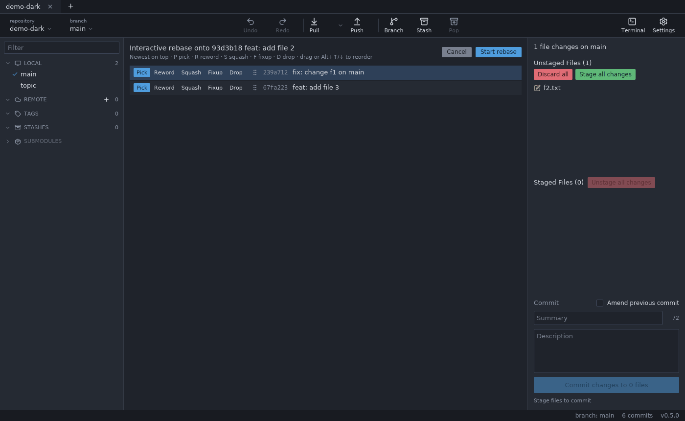
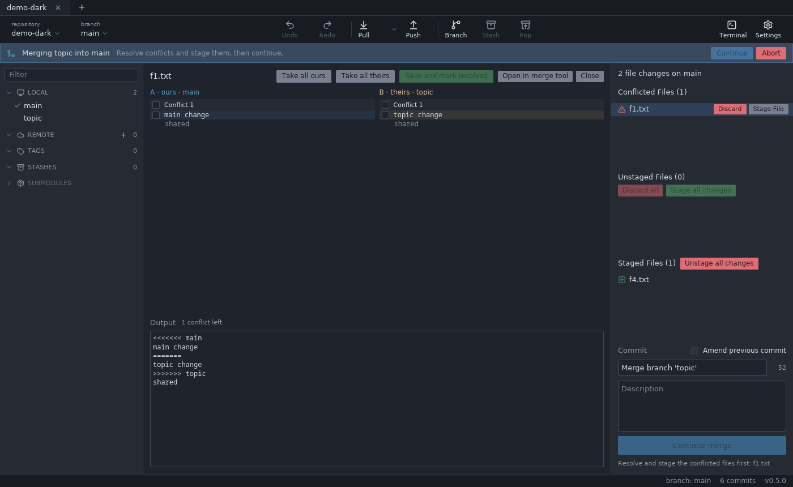

# Merge, rebase and conflicts

## Merge and fast-forward

Right click a branch: **Merge X into Y** merges it into the checked-out branch; **Fast-forward Y to X** appears when that is possible. For a remote branch, **Fast-forward L to origin/L** updates a local branch that is behind, even when it is not checked out.

You can also **drag a branch** (graph pill or left panel) onto another branch: a menu offers fast-forward, merge, rebase and interactive rebase. Entries that need the other branch checked out are disabled and say so.

If local changes block the operation, Gitloom offers **Stash and merge** / **Stash and rebase**: the changes are stashed, the operation runs, and the stash is applied again. If applying it conflicts, the stash stays in the list.

## Rebase

Branch menu → **Rebase Y onto X**. A rebase over merge commits asks first, because Git flattens them.

### Interactive rebase

Commit menu → **Interactive rebase from here** opens a panel with the commits from there to HEAD (newest on top):

- choose **pick**, **reword**, **squash**, **fixup** or **drop** per commit (keys P, R, S, F, D);
- reorder by dragging the grip or with Alt+↑/↓;
- edit reword and squash messages directly in the panel;
- **Start rebase** runs it; the panel tells how many merges would be dropped.

Shortcuts for common cases: **Edit commit message** in the commit menu (HEAD is amended, older commits are reworded) and **Squash N commits** for a contiguous multi-selection, both with a message dialog.

## Cherry-pick and revert

Commit menu → **Cherry-pick commit** or **Revert commit**. With several selected commits, **Cherry-pick N commits** applies them oldest first. Reverting a merge commit asks for the parent. An empty result offers **Skip** or **Commit empty**.

## Reset

Commit menu → **Reset <branch> to this commit** → **Soft** (keep changes staged), **Mixed** (keep changes unstaged) or **Hard** (discard changes). Hard always asks and lists the files whose changes will be lost; it can be undone.

Reset is also offered on the checked-out commit itself (while no merge, rebase, cherry-pick or revert runs): **Mixed** unstages everything and clears conflicts while keeping the files, **Hard** throws away all uncommitted changes (untracked files stay). **Soft** is disabled there ("HEAD is already at this commit"). Both can be undone, conflicts included.

## Operations in progress

While a merge, rebase, cherry-pick or revert is running, a banner shows it ("Rebasing topic onto main (step 2 of 5)") with **Continue**, **Skip** (rebase and cherry-pick) and **Abort**. The commit button becomes "Continue rebase" and so on; you can edit the commit message before continuing. Actions that would break the operation (amend, stash, undo of commits) are disabled with the reason in the tooltip. Continue stays disabled while files still have conflicts; its tooltip lists them.

## Stash conflicts

Popping or applying a stash can conflict with changes made after it was stashed. Gitloom then shows the conflicted files and a banner: "Stash '<name>' applied with conflicts. The stash was kept." Git keeps the stash so nothing is lost.

- **Undo** (in the banner, the toolbar or Ctrl+Z) returns to exactly the state before the pop or apply: files, staged changes and the stash list. If you already edited a conflicted file, Gitloom asks first.
- Or resolve the files in the conflict view; its sides are called **Updated upstream** (your current files) and **Stashed changes** (the stash). Once nothing is conflicted, the banner offers **Drop stash** (the stash is no longer needed) and **Keep stash**.
- Stash, Pop and Apply are disabled while files are conflicted: Git cannot apply a stash on top of conflicts.

Conflicted files without a running operation (for example after closing Gitloom during a stash conflict) show the banner "Conflicted files without a running operation": resolve them in the conflict view or **Discard conflicted files…**.

## Discarding conflicted files

Right click a conflicted file → **Discard changes**, "Discard all" or the banner action reset conflicted files to the checked-out commit (a file that is not in it is removed). Gitloom asks first, since both sides and any resolution are lost; Ctrl+Z brings the conflict back.

## Resolving conflicts

Conflicted files have their own section above the unstaged files. Click one to open the conflict view:

- A (your side, HEAD) on the left and B (the incoming side) on the right, each headed "Commit <short SHA> on <branch>", each hunk and line with a checkbox; a stash conflict keeps Git's "Updated upstream" / "Stashed changes";
- **Take all ours** / **Take all theirs**, or pick hunks and single lines;
- "conflict n of N" above the output with ↑/↓ arrows (or Alt+↑/↓) jumps between the open conflicts; past the last one it starts again at the first;
- the output below can be edited by hand (then picks no longer change it; **Reset output** starts over);
- **Save and mark resolved** writes the file and stages it.

Binary files, files larger than 2 MB and delete/modify conflicts take one side's whole file. Line endings are kept. **Open in merge tool** resolves the file in your configured merge tool instead.
