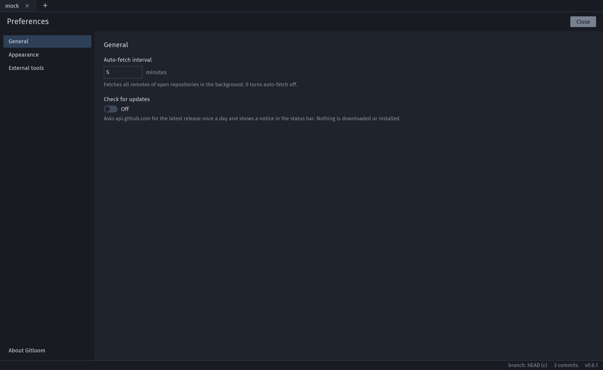
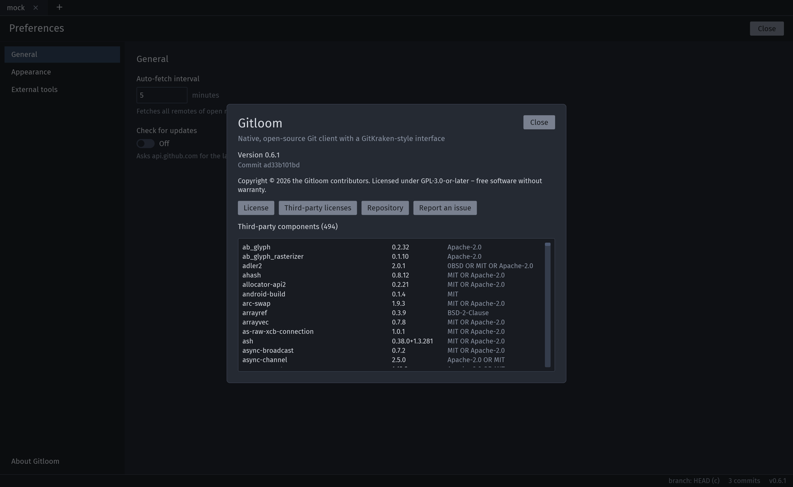

# Settings

**Preferences** (gear button or Ctrl+,) replace the tab content; categories are on the left. Changes apply immediately.

| Category | Setting |
|---|---|
| General | **Auto-fetch interval** in minutes (default 5, 0 turns it off). **Check for updates** (off by default, see [Privacy](privacy.md)). |
| Appearance | **Theme**: Dark, Light or System (follows the operating system; Dark if it reports nothing). **Zoom** 70–200 %. **Load avatars from Gravatar** (off by default). |
| Identities | Saved **identities** (name and email) for commits: **Add identity**, **Edit**, **Remove** and **Set as default**. **Keep the global Git config updated with the default identity** (on by default): setting or editing the default writes `user.name` and `user.email` to the global Git config; off, Gitloom never changes it. On first use Gitloom imports the identity of the global Git config as the first identity and default. |
| External tools | **Diff tool** and **merge tool**: Git's configuration (`diff.tool`, `merge.tool`) or a tool Git knows. **Terminal command** for Alt+T, with `{path}` for the repository folder; empty means the first terminal found. **External editor**: None, VS Code, VSCodium, Sublime Text, IntelliJ IDEA, Zed or Custom; a preset fills the command (`code {path}`), which you can edit; without `{path}` the path is added at the end. On Windows `code` finds `code.cmd`, and backslashes in paths are kept. |

Below the global categories, the group **Repository · <name>** holds the settings of the active tab's repository:

- **Identity**: the name and email the repository's commits use, with where they come from (repository or global Git config), and the same choices as "Committing as …" in the commit panel (see [Daily workflow](daily-workflow.md#committing)).
- **SSH key**: the key for fetch, pull and push (see [Branches and remotes](branches-and-remotes.md#ssh-key-per-repository)).
- **Gitflow** (see [Git flow](git-flow.md)).

 The group follows the active tab; on the start screen its categories are disabled ("Open a repository first").

At the bottom of the categories, **About Gitloom** shows the version, commit, license and third-party components.

## Zoom and fullscreen

Ctrl+= (or Ctrl++), Ctrl+- and Ctrl+0 zoom in 10 % steps from 70 to 200 %; the zoom is remembered. F11 toggles fullscreen.

## Files on disk

| File | Linux | macOS | Windows |
|---|---|---|---|
| Preferences, session (open tabs, recent repositories, hidden branches, update check) | `~/.config/gitloom/` | `~/Library/Application Support/Gitloom/` | `%APPDATA%\Gitloom\config\` |
| Crash reports | `~/.local/share/gitloom/crashes/` | `~/Library/Application Support/Gitloom/crashes/` | `%APPDATA%\Gitloom\data\crashes\` |
| Avatar cache | `~/.cache/gitloom/avatars/` | `~/Library/Caches/Gitloom/avatars/` | `%LOCALAPPDATA%\Gitloom\cache\avatars\` |

`settings.json` and `session.json` are plain JSON. A file that cannot be read is kept as `.bak` and defaults are used.
