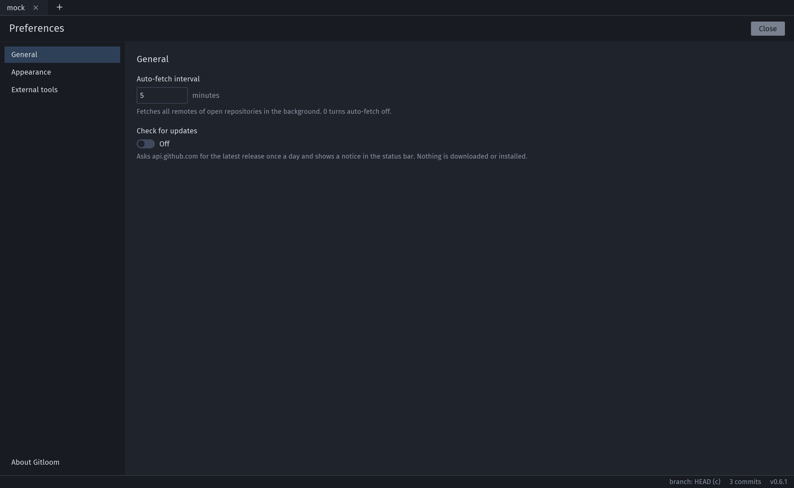
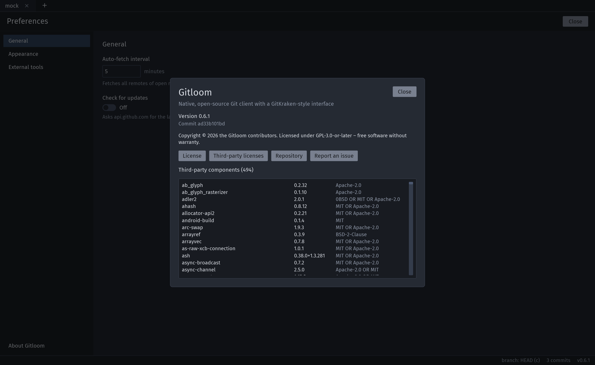

# Settings

**Preferences** (gear button or Ctrl+,) open as a window over the app (the whole window when it is small); categories are on the left. Changes apply immediately. **×** or Esc closes them; Tab stays inside.

**From the command palette** (Ctrl+P or Ctrl+Shift+P): every on/off setting has an entry "Toggle: <setting> (on/off)"; "Set: Theme ›", "Set: Diff view ›", "Set: Stash message template ›" and "Set: External editor ›" (with a repository tab also "Repository: External editor ›") open a list of values; "Preferences: <page>" and "Preferences: <setting>" open the Preferences at that page and highlight the setting for a moment. Search words like "profile", "gravatar" or Git config names (`init.defaultBranch`) find them too. Repository entries appear only with a repository tab.

| Category | Setting |
|---|---|
| General | **Auto-fetch interval** in minutes (default 5, 0 turns it off). **Prune remote branches on fetch** (on: fetch, auto-fetch and pull remove remote branches deleted on the remote; off: Git's `fetch.prune` applies). **Support long paths** (Windows: `core.longpaths` in the global Git config). **Default branch name** of new repositories (`init.defaultBranch`, global Git config; empty removes it). **Check for updates** (off by default, see [Privacy](privacy.md)). |
| Appearance | **Theme**: ten built-in themes, grouped into dark (Dusk, Studio Dark, Monokai, Midnight, Warm Dark) and light ones (Light, Studio Light, Sepia, Daylight, Warm Light), each with a color strip; the window, graph, diffs and syntax colors follow the theme at once. **System** follows the operating system: two more lists choose the theme for a dark and for a light system (Dusk and Light by default; the dark choice is used when the system reports nothing). A theme that is no longer there (e.g. a hand-edited `settings.json`) is named in a note and Dusk (or Light for the light System slot) is used. **Manage themes…** opens the theme list in place of Appearance: your own themes (**New theme** copies any theme, edit its colors with a preview, **Rename…**, **Delete…**, **Import…**, **Export…**, **Open folder**; built-in themes are read only); **← Appearance** or Esc goes back. See [Themes](themes.md). **Zoom** 70–200 %. **Load avatars from Gravatar** (off by default). **Show toolbar labels** (on; off shows icons with the names as tooltips). **Show commit author / date and time / SHA in graph** (also in the gear menu above the graph). |
| Editor | For diffs, blame, file history and the conflict view (not the commit message fields): **Font** (the monospace fonts installed; Default is the system's), **Font size** 8–24, **Tab size** 1–8 (tabs are shown as that many columns; files are not changed), **Show line numbers**, **Word wrap** (long lines continue on the next rows in diffs, no horizontal scrolling then), **Syntax highlighting** (colors per theme, from the top of the file down while you look; files over 8 MB and single lines over 5,000 characters stay plain). The language of a single file is chosen in the status bar, not here (see [Daily workflow](daily-workflow.md#diffs)). |
| Identities | Saved **identities** (name and email) for commits: **Add identity**, **Edit**, **Remove** and **Set as default**. **Keep the global Git config updated with the default identity** (on by default): setting or editing the default writes `user.name` and `user.email` to the global Git config; off, Gitloom never changes it. On first use Gitloom imports the identity of the global Git config as the first identity and default. |
| Signing | **Format** GPG (OpenPGP) or SSH; **Signing key** (GPG secret keys of the GPG program with expired ones marked, **Refresh**; SSH: public keys from `~/.ssh` or **Browse…**); **GPG program** (empty: `gpg`); **Sign commits by default**, **Sign tags by default**. All in the global Git config (`gpg.format`, `user.signingkey`, `gpg.program`, `commit.gpgSign`, `tag.gpgSign`); values the repository sets itself are listed as "Overridden in this repository". Passphrases are asked by GPG's pinentry or the SSH agent, never by Gitloom. |
| Templates | **Commit message prompt (all repositories)**: the instruction of "Copy commit message prompt…", with **Reset to default**. **Stash message**: **Use stash message template** (off: Git's default message), a preset such as `{branch} · {datetime}` or **Custom** with `{branch}` (`detached` without a branch), `{date}`, `{time}`, `{datetime}`, `{sha}`, `{summary}`; a preview shows the message for the active repository; an unknown placeholder or an empty custom text falls back to Git's default. |
| External tools | **External editor**, **Diff tool** and **Merge tool** are chosen from your tool list (see [External tools](#external-tools)): the editor is "None" or a tool with an open command; diff and merge are "Use Git config" (`diff.tool`, `merge.tool`), "None", a tool with a diff or merge command, or another tool Git knows ("<name> (Git)"). **Manage tools…** next to each picker opens the list. **Terminal command** for Alt+T, with `{path}` for the repository folder; empty means the first terminal found. **Delete .orig files after merging** (off; on: the merge tool keeps no `.orig` backup). |

Below the global categories, the group **Repository · <name>** holds the settings of the active tab's repository:

- **Identity**: the name and email the repository's commits use, with where they come from (repository or global Git config), and the same choices as "Committing as …" in the staging area (see [Daily workflow](daily-workflow.md#committing)).
- **SSH key**: the key for fetch, pull and push (see [Branches and remotes](branches-and-remotes.md#ssh-key-per-repository)).
- **Commit**: the commit template like GitKraken's: **Apply this template to commit messages**, **Remove comments from commit messages** (lines starting with `core.commentChar`, `#` by default), **Summary**, description, **Save commit template**. It is Git's `commit.template` file; without one, saving creates `.git/gitloom/commit-template.txt` for this repository. A template in the global Git config is changed only after "This template is used by all repositories. Change it?".
- **External editor**: **Use global setting** or a tool of your list for this repository only (its open command is stored in the repository's Git config); Alt+E, the toolbar, the palette and the file menus use it. A command stored there that is not in your list shows as "<program> (not in the list)" and still works.
- **Gitflow** (see [Git flow](git-flow.md)).

 The group follows the active tab; on the start screen its categories are disabled ("Open a repository first").

At the bottom of the categories, **About Gitloom** shows the version, commit, license and third-party components.

## External tools

Gitloom has no built-in list of editors and tools. You build the list yourself in Preferences → External tools → **Manage tools…** and pick one tool each for the external editor, the diff tool and the merge tool. A fresh installation has one tool, **VS Code**; nothing is chosen until you pick it.

Each tool has a name and up to three commands. Leave a command empty when the tool should not be used for that purpose; it is then not offered in that picker.

| Command | Placeholders | Example |
|---|---|---|
| Open | `{path}`: the folder or file (added at the end when missing) | `code {path}`, `zed {path}`, `"C:\Program Files\Sublime Text\sublime_text.exe" {path}` |
| Diff | `{local}` and `{remote}`: the old and the new version (both required) | `code --wait --diff {local} {remote}`, `meld {local} {remote}` |
| Merge | `{merged}`: the file to save the result to (required); `{local}` (ours), `{remote}` (theirs), `{base}` (the common version) | `code --wait --merge {remote} {local} {base} {merged}`, `meld --output={merged} {local} {base} {remote}` |

- Programs are found on the PATH (on Windows `code` finds `code.cmd`); put a full path in quotes. Backslashes in Windows paths are kept.
- Diff and merge commands are kept in Gitloom's settings only and run through `git difftool` / `git mergetool`; your Git configuration is not changed. A merge counts as resolved when the tool saved the file.
- The tool must wait until you close it (`--wait` for VS Code and Zed): otherwise Git deletes the two versions before the tool shows them.
- **New tool** adds an empty tool, **Duplicate** copies the selected one ("<name> copy"), **Delete…** asks first and says where the tool is used; those settings become "None". **Restore VS Code** brings VS Code back at the top, or resets its name and commands; your other tools stay as they are.
- A problem (no name, a name used twice, an unclosed quote, a diff command without `{local}` or `{remote}`, a merge command without `{merged}`) is shown under the field and marked in the list; the tool is not offered for that purpose until it is fixed.
- Settings from before this version keep everything except the editor and tool choices: set them again in the list.

## Zoom and fullscreen

Ctrl+= (or Ctrl++), Ctrl+- and Ctrl+0 zoom in 10 % steps from 70 to 200 %; the zoom is remembered. F11 toggles fullscreen.

## Files on disk

| File | Linux | macOS | Windows |
|---|---|---|---|
| Preferences, session (open tabs, recent repositories, hidden branches, update check) | `~/.config/gitloom/` | `~/Library/Application Support/Gitloom/` | `%APPDATA%\Gitloom\config\` |
| Crash reports | `~/.local/share/gitloom/crashes/` | `~/Library/Application Support/Gitloom/crashes/` | `%APPDATA%\Gitloom\data\crashes\` |
| Your themes (one `.json` file each, see [Themes](themes.md#file-format)) | `~/.config/gitloom/themes/` | `~/Library/Application Support/Gitloom/themes/` | `%APPDATA%\Gitloom\config\themes\` |
| Avatar cache | `~/.cache/gitloom/avatars/` | `~/Library/Caches/Gitloom/avatars/` | `%LOCALAPPDATA%\Gitloom\cache\avatars\` |

`settings.json` and `session.json` are plain JSON. A file that cannot be read is kept as `.bak` and defaults are used. `session.json` also keeps the language you chose for a file (status bar) for as long as the repository's tab is open.
